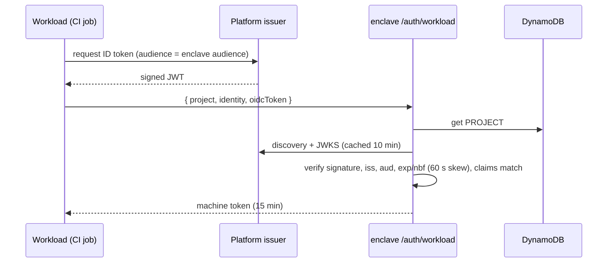
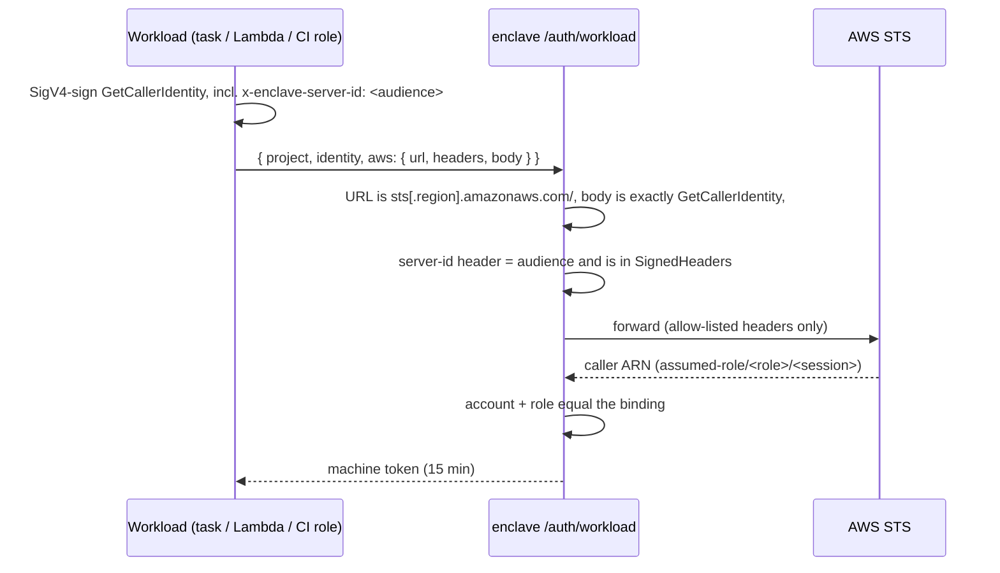

# Machine identities

A machine identity lets a workload — a CI job, a container, a Lambda, a pod —
read or write a project's env files with the identity its platform already
gives it. The project owner writes a **binding** that says which external
identity maps to which stages, and with what access. The workload exchanges a
proof of that identity for a short-lived enclave token.

No long-lived enclave credential is ever issued to a workload, and the service
never holds one of the workload's credentials.

Code: `infra/functions/lib/machines.ts` (bindings),
`lib/oidc.ts` and `lib/awsiam.ts` (verifiers), `auth/workload.ts` (login),
`lib/access.ts` (`authorize`), `cli/enclave/workload.py` (client side).

## Bindings

A binding is stored next to the project's human members:

```
PROJECT#<project> / MACHINE#<id>
  kind      "oidc" | "aws"
  oidc:     issuer, audience?, claims { <claim name>: <pattern> }
  aws:      account, role
  stages[]  subset of the configured stages
  access    "read" | "write"
  rev       random, fresh on every write
  description?, createdBy, createdAt, grantExpiresAt? (enterprise)
```

Only the project owner can create, change or remove a binding
(`POST /admin/projects/{p}/machines`, `.../machines/remove`).

### Two kinds

| Kind | Proof the workload presents | Typical sources |
|---|---|---|
| `oidc` | An ID token from the binding's issuer, with the right audience, whose claims match every constraint | GitHub Actions (`https://token.actions.githubusercontent.com`), GitLab CI, Kubernetes service-account tokens, any OIDC provider with discovery and JWKS |
| `aws` | An `sts:GetCallerIdentity` request signed with the workload's AWS credentials | ECS task roles, Lambda roles, EC2 instance profiles, CI roles assumed via OIDC |

### Claim patterns

Constraints are `claim name -> pattern`. `*` matches any run of characters
*except* `:`, so it can't jump across the segments of a GitHub subject:

| Pattern on `sub` | Admits |
|---|---|
| `repo:acme/api:ref:refs/heads/main` | the `main` branch of `acme/api` |
| `repo:acme/api:ref:refs/heads/*` | any branch of `acme/api` |
| `repo:acme/*:ref:refs/heads/main` | `main` of any `acme` repository |
| `repo:acme/api:environment:production` | jobs in the protected `production` environment |

Numbers and booleans in the token are compared as strings.

### Rules that refuse a dangerous binding

A shared issuer such as GitHub, gitlab.com or a cloud's Kubernetes OIDC signs
tokens for *everyone* on that platform. A binding that only constrains the
shape of a claim would admit strangers. `validateBinding()` therefore requires:

- **GitHub:** the owner must be pinned literally. That means `sub` starting with
  `repo:<owner>/`, `repository` starting with `<owner>/`, or a numeric
  `repository_id` / `repository_owner_id`.
- **Other issuers:** `sub` must have a literal prefix of at least three
  characters before any `*`.
- **Every constraint:**
  - between 1 and 10 constraints in total
  - no constraint that is only `*`
  - none on `iss`, `aud`, `exp`, `nbf` or `iat`, because the server checks those
    itself
- **Issuer URL:**
  - `https`, with a hostname, not an IP literal
  - no port and no credentials
  - not `localhost`, `*.local` or `*.internal`
- **AWS:**
  - a 12-digit account
  - an exact role name, with no wildcards and no path
  - only roles; IAM users can't be bound

## Login

`GET /api/auth/workload` returns the deployment's `audience` and the name of
the server-id header. `POST /api/auth/workload` takes
`{ project, identity, oidcToken }` or `{ project, identity, aws }`.

### OIDC



How the token is verified:
- **Algorithms:** RS256/384/512, PS256/384 and ES256/384. `none` and HMAC are
  never accepted.
- **Discovery:** the discovery document's `issuer` must equal the binding's
  issuer exactly.
- **JWKS caching:** keys are cached per issuer for 10 minutes. A token with an
  unknown `kid` can force at most one refetch per minute.
- **Fetch limits:** every fetch is redirect-free, times out after 3 seconds and
  is capped at 256 KB. Owners supply issuer URLs, so they get the same SSRF
  guards as the binding validator.
- **Audience:** defaults to the deployment's audience. That's the site URL, or
  `enclave-envoy:<account>:<stage>` without a domain. A binding may override it
  for issuers that can't choose the audience.

### AWS IAM (signed STS request)

This is the method Vault's `aws` auth uses. The workload signs a
`GetCallerIdentity` request but doesn't send it; enclave forwards it to STS
unchanged, and STS says who signed it.



Properties:
- **The workload's AWS credentials never leave it.** A signed request isn't a
  credential: it is valid for one action, against one endpoint, for about 15
  minutes.
- **The service needs no AWS permission** to verify the request.
- **Replay elsewhere is prevented.** The signature covers the
  `x-enclave-server-id` header, so a request signed for another enclave
  deployment, or for a Vault server, is rejected here.
- **Forwarded headers are allow-listed:** `authorization`, `content-type`,
  `x-amz-date`, `x-amz-security-token` and the server-id header. Everything
  else is dropped. Only the global STS endpoint and regional
  `sts.<region>.amazonaws.com` endpoints are accepted, so the Lambda can't be
  pointed at arbitrary URLs.

### Failures

Every failure, including an unknown project, an unknown binding, the wrong kind,
a bad signature or a claim mismatch, returns the same `401 workload
authentication failed`. The endpoint can't be used to find out which projects
or bindings exist. The real reason goes to the function log only.

## The machine token

```json
{ "sub": "machine:webapp/deploy", "typ": "machine",
  "prj": "webapp", "mid": "deploy", "rev": "<binding rev>",
  "src": "<issuer>#<sub> | <caller ARN>", "exp": "<now + 900>" }
```

- **15 minutes** of validity. A CI job or container logs in again when it needs
  to; the CLI does this transparently.
- **`rev` binds the token to one version of the binding.** Every write to the
  binding sets a fresh `rev`, so editing the binding's stages, access or claims
  invalidates outstanding tokens immediately.
- **`src`** records the concrete external identity (which repo and ref, which
  role session) for the audit trail.
- **Admin endpoints refuse machine tokens** (`requireAuth()`). A machine can't
  create projects, invite members, edit bindings or become an owner. The only
  things it can do are fetch data keys and presigned URLs for its stages.

## Authorization and revocation

`authorize()` re-reads the binding on every vault call and requires all of the
following:
- the binding still exists
- its `rev` equals the token's `rev`
- it belongs to the token's project
- it lists the requested stage
- it hasn't expired (enterprise `grantExpiresAt`)
- it grants `write` when the action is a write

So:

| Owner action | Effect on a running workload |
|---|---|
| Remove the binding | next vault call fails |
| Remove a stage, downgrade to read | next vault call fails (new `rev`) |
| Change the claim patterns | next vault call fails (new `rev`), even if the old token would still match |
| Binding expiry reached (enterprise) | next vault call fails |

The cost is one DynamoDB `GetItem` per vault call, which is negligible next to
the KMS and S3 calls it guards.

## Threat model

| Threat | Mitigation |
|---|---|
| A stranger's GitHub workflow mints a token for our audience | Owner pinning is mandatory; the claims must match a literal owner or repository |
| A feature branch or fork PR reads prod secrets | Pin `ref` or a protected `environment` in the binding; the enterprise access review flags GitHub bindings that don't (`any-branch`) |
| A malicious issuer URL used for SSRF | https only, hostnames only, no redirects, size and time caps |
| A signed STS request replayed against this service | STS's 15-minute signature window, plus the signed server-id header |
| A stolen machine token | 15-minute lifetime, limited to the binding's stages, no admin rights; revoked on the next call by removing or editing the binding |
| Probing which projects exist | Uniform 401 |
| A machine escalates to owner | Admin API refuses machine tokens |

## Out of scope

- **SPIFFE/SPIRE, Azure and GCP workload identity:** not supported directly.
  Any of them that exposes an OIDC issuer with discovery works as `oidc`.
- **Mutual TLS:** not used. Identity comes from the platform token or the
  signed request, not from the transport.
- **Machine-to-machine delegation:** a machine token can't mint other tokens.
